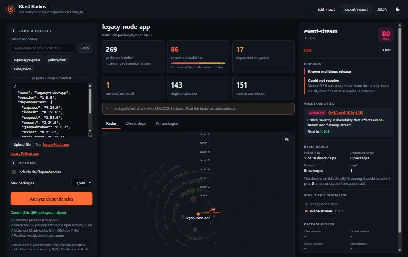

# Blast Radius

**See everything your dependencies drag in.**

A typical app lists a dozen dependencies and installs hundreds. Blast Radius resolves the *entire* transitive tree for an npm or Python project, then answers the questions `npm audit` doesn't:

- **Which packages are actually dangerous?** Known CVEs, malware, deprecated or yanked releases, install scripts, single-maintainer packages, abandoned code.
- **Why is this even installed?** The shortest chain from your project to any package, and which of *your* direct dependencies pull it in.
- **What does each dependency really cost me?** Total footprint, inherited risk, and how many packages would disappear if you dropped it.

Everything runs client-side in the browser. There's no backend and no API keys; it talks only to public APIs.



## Try it

```bash
npm start            # serves the app at http://localhost:8080
```

Then either:

- click **legacy Node app** or **legacy Python app** for a pre-loaded demo,
- type a GitHub repo (`expressjs/express`, or a `github.com/.../tree/main/packages/x` URL), or
- paste, upload or drag in a `package.json`, `package-lock.json`, `requirements.txt` or `pyproject.toml`.

Links are shareable: `#gh=owner/repo` and `#example=npm` load automatically.

> Any static file server works (`python -m http.server`). The page uses ES modules, so it can't be opened from `file://`. It deploys to GitHub Pages as-is.

## What the demo finds

The bundled `legacy-node-app` pins ten once-popular packages. Blast Radius resolves them to **269 installed packages, 8 levels deep**, and surfaces:

- `event-stream@3.3.6`: the 2018 [flatmap-stream supply-chain attack](https://blog.npmjs.org/post/180565383195/details-about-the-event-stream-incident). npm unpublished it, so a plain resolver just fails. Blast Radius still checks the exact pin against OSV and flags it as **known malicious**.
- `node-sass` alone brings in **196 packages**, and **149 of them** exist only because of it. It's deprecated and runs a native build on install.
- 86 advisories (4 critical), each with the version that fixes it.

The Python demo shows a different class of problem: `requests==2.19.0` requires `urllib3<1.24`, but `urllib3==1.24.1` is pinned. Blast Radius reports the conflict the same way pip would refuse it.

## How it works

```
manifest ──► detect format ──► resolve full graph ──► enrich ──► analyze ──► radar / tables / report
                               (npm · lockfile · PyPI)  (OSV, downloads)  (risk + blast radius)
```

| Stage | Module | Notes |
| --- | --- | --- |
| Parsing | [`parse.js`](src/parse.js) | package.json, lockfiles, requirements.txt (options, hashes and continuation lines), pyproject `[project]` (a string scanner, since a regex trips on `pkg[extra]`). |
| npm resolution | [`resolve-npm.js`](src/resolve-npm.js) | Concurrent BFS over the registry. It mirrors npm's version choice (prefers `latest` when it satisfies the range) and handles aliases (`npm:`), git/URL/file sources and auto-installed peer deps. |
| Lockfiles | [`resolve-lock.js`](src/resolve-lock.js) | Reproduces Node's module resolution (`node_modules` walk-up) over the lockfile layout to get the exact installed graph. Supports v1, v2 and v3, links and dev flags. |
| PyPI resolution | [`resolve-pypi.js`](src/resolve-pypi.js) | One version per package, with top-level pins winning. Supports extras, including extras requested later that switch on more dependencies of an already-resolved node. Reports conflicts. |
| PEP 440 | [`pep440.js`](src/pep440.js) | From scratch: version parsing, total ordering (`1.0.dev0 < 1.0a1 < 1.0 < 1.0.post1`), `~=`, `==1.*`, and the exclusive-ordered-comparison rules for pre and post releases. |
| PEP 508 markers | [`markers.js`](src/markers.js) | Tokenizer and recursive-descent parser for `python_version < "3.8" and (extra == 'socks' or ...)`, evaluated against a CPython 3.12 / Linux target. |
| Vulnerabilities | [`enrich.js`](src/enrich.js) | Batched OSV.dev queries, deduplicating aliases (PYSEC-* and GHSA-* for the same bug). Picks the nearest fixed version above the installed one. Detects malware via OSV `MAL-*` IDs and CWE-506. |
| CVSS | [`cvss.js`](src/cvss.js) | CVSS v3.x base-score calculator from the spec, used when an advisory has a vector but no severity label. |
| Analysis | [`analyze.js`](src/analyze.js) | Risk scoring and graph metrics (below). |
| Radar | [`graph-view.js`](src/graph-view.js) | Canvas plus d3-force with a radial force per depth ring. Zoom, pan and drag, with ancestor/descendant path highlighting. Labels appear progressively by zoom level and risk. |

### Metrics

- **Footprint**: the number of packages a node pulls in transitively.
- **Pulled in by**: which of your direct dependencies can reach this package. This tells you what you'd have to replace to get rid of it.
- **Gone if dropped**: packages reachable from exactly one direct dependency, so removing that dependency removes them.
- **Inherited risk**: the sum of risk scores over a direct dependency's whole subtree. This ranks the Direct deps view.

### Risk score (0–100 per package)

| Signal | Points |
| --- | --- |
| Known vulnerability | critical 35 · high 25 · medium 12 · low 4 (capped at 60) |
| Known malicious release | +40 |
| Could not resolve / unpublished | 20 |
| Deprecated or yanked | 15 |
| No release in 4+ years / 2+ years | 14 / 8 |
| Install scripts (`preinstall`, `install`, `postinstall`, node-gyp) | 12 |
| Installed from git/URL (invisible to audits) | 10 |
| Single maintainer (no org) | 8 |
| Under 1,000 weekly downloads (npm) | 6 |
| Major version behind | 3 |

The weights are opinionated, and they live in one function (`scoreNode`) so they're easy to change.

## Tests

```bash
npm test
```

The tests use `node:test` with no dependencies. They cover PEP 440 ordering and specifiers, marker evaluation, every manifest format, lockfile path resolution (including v1 conversion), blast-radius metrics on a hand-built graph, the CVSS calculator against NVD reference scores, advisory fix-version selection and repository-URL normalization.

## Limits and ideas

- npm resolution approximates npm's algorithm: it doesn't model hoisting or `overrides`. For exact results, use a `package-lock.json`.
- Python resolution is greedy (first choice wins) rather than backtracking like pip's resolver, and the target environment is fixed.
- Not yet supported: `yarn.lock`, `pnpm-lock.yaml`, Poetry and uv lockfiles, other ecosystems (OSV also covers crates.io, Go and Maven).
- Ideas: diff two manifests ("what does this upgrade change?"), a CI mode that fails on new critical findings, and OpenSSF Scorecard data per repo.

## Tech

Vanilla JS (ES modules), with [d3](https://d3js.org) for forces and zoom and [semver](https://github.com/npm/node-semver) for npm ranges, both loaded through an import map. There's no build step. Data sources: npm registry, npm downloads API, PyPI JSON API, [OSV.dev](https://osv.dev), GitHub raw.

MIT licensed.
